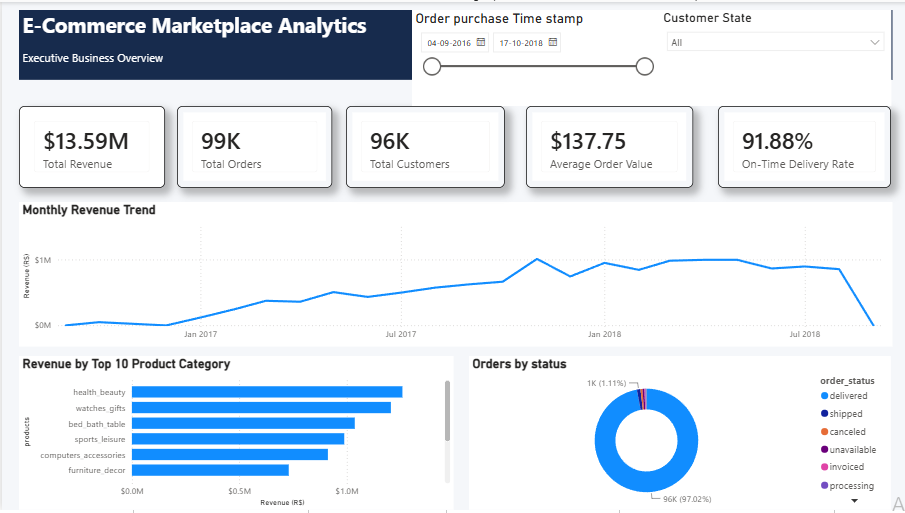
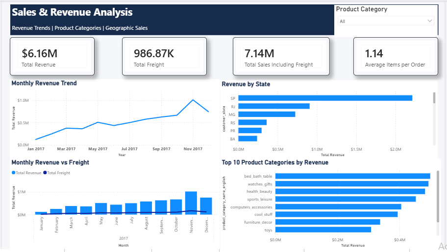
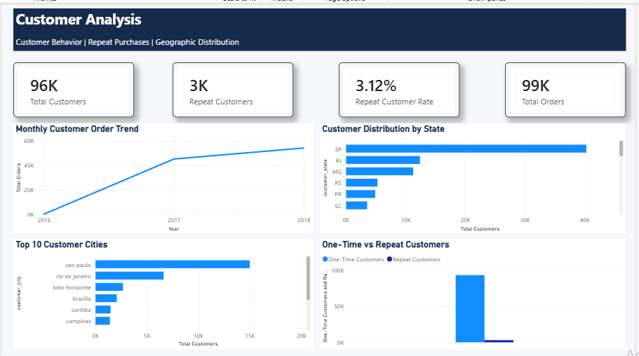
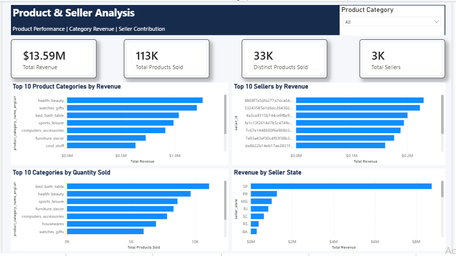
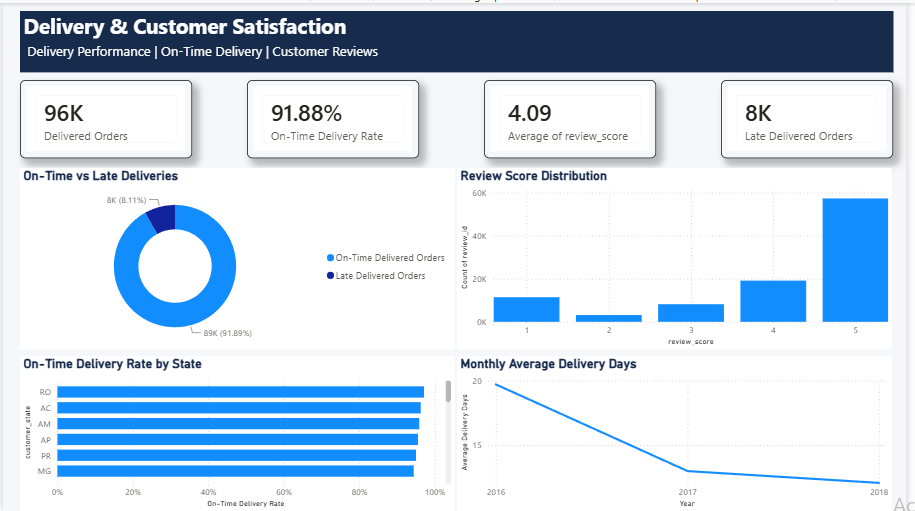
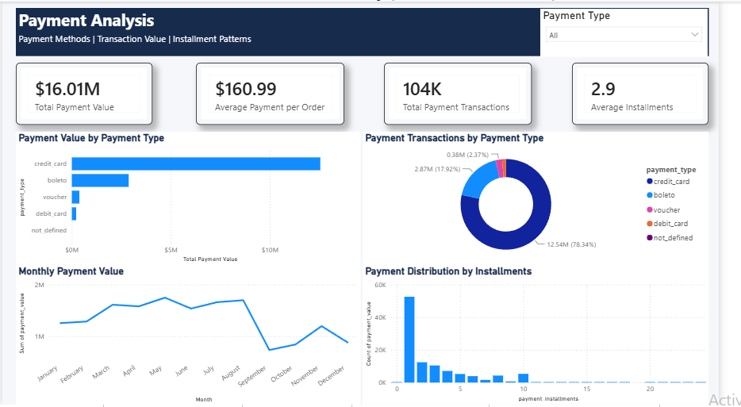

# E-Commerce Marketplace Analytics & Business Intelligence Platform

## Project Overview

An end-to-end e-commerce analytics project using the Brazilian E-Commerce Public Dataset by Olist.

The project explores marketplace performance across sales, customers, products, sellers, payments, delivery, and customer satisfaction. It transforms raw datasets into structured information and interactive Power BI dashboards to support business analysis and decision-making.

## Business Objectives

- Analyze sales and revenue performance.
- Understand customer purchasing and repeat-purchase behavior.
- Identify high-performing product categories and sellers.
- Evaluate delivery performance and customer satisfaction.
- Analyze payment methods and transaction patterns.
- Present business findings through interactive dashboards.

## Dataset

**Source:** Brazilian E-Commerce Public Dataset by Olist  
**Platform:** Kaggle  
**Dataset link:** https://www.kaggle.com/datasets/olistbr/brazilian-ecommerce

The dataset contains nine CSV files covering customers, orders, order items, payments, reviews, products, sellers, geolocation, and product category translations.
**Note:** The original and cleaned CSV datasets are not included in this repository. Download the dataset from Kaggle using the link above.
## Tools and Technologies

| Tool | Purpose |
|---|---|
| Python | Data exploration and cleaning |
| Pandas | Data manipulation and processing |
| NumPy | Numerical operations |
| Jupyter Notebook | Python development |
| PostgreSQL 18 | Relational database |
| pgAdmin | Database management |
| SQL | Data querying and business analysis |
| Power BI Desktop | Interactive dashboards |

## Project Workflow

1. **Data Collection:** Obtained the Olist dataset from Kaggle.
2. **Data Exploration:** Examined dataset structure, columns, data types, and quality using Python.
3. **Data Cleaning:** Handled missing values, duplicates, data types, and consistency issues.
4. **Database Development:** Created PostgreSQL tables and established primary and foreign key relationships.
5. **SQL Analysis:** Performed business analysis using SQL queries, joins, aggregations, and advanced techniques.
6. **Power BI Development:** Connected the database, created relationships and DAX measures, and built six interactive dashboards.
7. **Business Reporting:** Prepared a report summarizing key findings and recommendations.

## Power BI Dashboards

### 1. Executive Overview
Provides a high-level view of marketplace performance through revenue, orders, customers, average order value, and delivery indicators.

### 2. Sales & Revenue Analysis
Explores monthly revenue, freight, revenue by state, and product category performance.

### 3. Customer Analysis
Examines customer distribution, monthly order activity, and repeat versus one-time customers.

### 4. Product & Seller Analysis
Highlights category revenue, product quantities, seller contribution, and seller-state performance.

### 5. Delivery & Customer Satisfaction
Analyzes delivery performance, on-time and late deliveries, review scores, and delivery duration.

### 6. Payment Analysis
Examines payment methods, transaction values, payment activity, and installment patterns.

## Key Findings

- Product revenue: R$13,591,643.70
- Freight value: R$2,251,909.54
- Unique customers: 96,096
- Delivered orders: 96,478
- Repeat customer rate: 3.12%
- Average product item price: R$120.65

*Revenue represents product item prices, not profit. These figures are based on the analyzed historical dataset.*

## Repository Structure

Ecommerce-Marketplace-Analytics/
│
├── 02_Python/
│   └── 01_Data_Exploration.ipynb
│
├── 03_SQL/
│   ├── 01_Database_Setup.sql
│   ├── 02_Create_Tables.sql
│   ├── 03_Keys_and_Relationships.sql
│   ├── 04_SQL_Fundamentals.sql
│   ├── 05_Business_Analysis.sql
│   ├── 06_Advanced_SQL_Analysis.sql
│   └── 07_Business_Insights.sql
│
├── 04_PowerBI/
│   └── README.md
│
├── 05_Reports/
│   ├── Business_Insights_Report.docx
│   └── Dashboard_Screenshots/
│       └── Six dashboard screenshots
│
├── .gitignore
└── README.md
## How to Explore the Project

1. Review the Python notebook for data exploration and cleaning.
2. Review the SQL scripts for database creation and business analysis.
3. Open the Power BI file to explore the six interactive dashboards.
4. Read the Business Insights Report for findings and recommendations.

## Project Outcome

The project demonstrates an end-to-end analytics workflow, from raw data preparation and relational database development to SQL analysis, interactive business intelligence dashboards, and business reporting.

## Dashboard Previews

### 1. Executive Overview

### 2. Sales & Revenue Analysis

### 3. Customer Analysis

### 4. Product & Seller Analysis

### 5. Delivery & Customer Satisfaction

### 6. Payment Analysis

